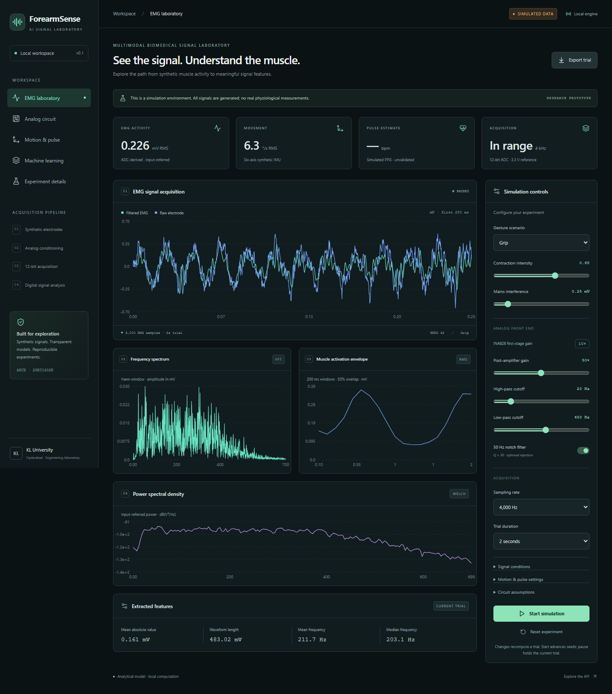

# ForearmSense AI

**EMG and Motion-Based Grip Activity and Stability Analysis**

Available-hardware project design: [Arduino Uno + BioAmp EXG Pill + MPU-6050 mapping](docs/fixed-hardware-project-map.md). This maps the original plans and academic report to the user-confirmed hardware; the current application remains a synthetic laboratory until live acquisition is implemented.

Revised academic report: [PDF](output/pdf/ForearmSense_AI_AECD_PBL_REVISED_UNO.pdf) and [editable manuscript](docs/ForearmSense_AI_AECD_PBL_REVISED_UNO.md).

Design and Simulation of an Intelligent Multimodal Forearm Wearable for EMG-Based Muscle Activity and Motion Monitoring. AECD · 25EC1302E · KL University, Hyderabad.

| Team member | Roll number |
| --- | --- |
| A Jaswant Goud | 2510040007 |
| G Abhishek | 2510040015 |
| O GopiChand | 2510040023 |
| C Meghasyam | 2510040072 |

## Report and implementation scope

Confirmed hardware: **Arduino Uno + one BioAmp EXG Pill + MPU-6050 + hand gripper**. Uno revision, ADC settings, firmware, acquisition rate and module calibration remain unverified. There is no working optical pulse sensor or instrumented force sensor.

The dashboard opens with **Project overview**: hardware, capability status and the planned 35-second rest/grip protocol. Laboratory tabs run educational simulations. Custom INA826/OPA2376 gains, 12-bit/3.3 V ADC settings, high-rate spectral analysis and generated PPG are model assumptions, not properties measured on the available hardware.

**Live acquisition, real-session recording and replay are planned**, as stated in the report. Measured HR, SpO2, force, blood flow and absolute heading are unavailable. The legacy approximately 250 Hz output cannot preserve a 20-450 Hz EMG spectrum.

[project.json](project.json) is the shared hardware/status/protocol contract used by the dashboard and `/api/project`. Trial API responses and exports retain synthetic provenance and the educational-model boundary. See [report alignment](docs/report-alignment.md) for the directory map and evidence boundaries.

## What works

The first milestone implements an end-to-end, local synthetic EMG laboratory: reproducible electrode signals → analytical INA826 gain → second-order high-pass → optional notch → fourth-order low-pass → post-gain → clipped 12-bit ADC → FFT / PSD / windowed features → React dashboard. Six-axis IMU, PPG, verified downsampling to 1 kHz, and five trial-grouped gesture classifiers are also integrated. All chart samples and benchmark scores come from Python execution; the frontend does not invent fallback readings.

The problem is to explore how electrode artifacts, filtering, gain and quantization affect a small muscle signal before building hardware. This prototype demonstrates signal processing and model assumptions; it does not measure a person or validate a wearable.

**Every signal is synthetic.** No clinical claims, measured grip force, SpO₂, absolute yaw or real human gesture recognition. The revised report now defines the fixed-hardware project. The custom-AFE model below is retained as educational analysis rather than BioAmp calibration. Dashboard waveforms remain analytical. Separate actual SPICE checks verify an ideal-buffer R/C candidate and OPA2376 gain; INA826 macro-model compatibility fails its gain check, so full device-chain SPICE remains unverified.

## Install on Windows

Prerequisites: Python 3.12, Node.js 22 or newer, npm. Commands run from this project directory in PowerShell. No activation or execution-policy change is needed for Python.

```powershell
python -m venv .venv
.\.venv\Scripts\python.exe -m pip install -r backend\requirements-lock.txt
Push-Location frontend
npm.cmd ci
Pop-Location
```

`requirements.txt` gives supported ranges; `requirements-lock.txt` records the versions used for verification. `package-lock.json` locks frontend packages. No cloud accounts, tokens, or paid services are required.

## Start the application

```powershell
& .\scripts\start.ps1
```

Open **http://127.0.0.1:5173**. API reference: **http://127.0.0.1:8000/docs**. Ctrl+C stops the launcher's two child servers. Both bind to loopback. If PowerShell blocks local scripts, use the two-terminal commands below rather than changing machine policy.

For a verified production build served locally:

```powershell
& .\scripts\start.ps1 -Production
```

Alternatively, terminal 1 (project root):

```powershell
.\.venv\Scripts\python.exe -m uvicorn app.main:app --app-dir backend --host 127.0.0.1 --port 8000
```

Terminal 2 (project root):

```powershell
Set-Location frontend
npm.cmd run dev
```

Vite proxies `/api` to FastAPI, avoiding permissive CORS. The launcher refuses occupied ports rather than stopping unrelated processes. Runtime logs are written in the project root when using the launcher.

## Demonstrate

1. Inspect the seed-42 trial. The waveform view shows its first 250 ms without display decimation; the RMS chart and export cover the whole trial.
2. Start to advance through new seeded trials. Pause holds the last completed trial. These are separate experiments, not a continuous acquisition stream.
3. Change intensity, noise, electrode offset, gain, cutoffs, sampling rate or notch. Changes regenerate a trial, including while paused.
4. Open **Analog circuit** for continuous-time magnitude/phase, ADC output and LP-only anti-aliasing checks.
5. Open **Motion & pulse** for acceleration, pitch/roll, pulse and estimated heart rate. All modalities share t = 0, with their own sample rates.
6. Export the full numerical response as JSON. Reset restores the original configuration and seed.

Expand **Motion & pulse settings** for stationary/repetitive/tremor/sudden motion and clean/artifact/low-perfusion/dropout PPG scenarios. Select 5 or 10 seconds for a clean PPG heart-rate estimate; poor quality or short trials withhold HR. Quality uses known injected components, not a clinical SQI. Expand **Circuit assumptions** to vary electrode resistance, temperature and R/C tolerances; the **Analog circuit** view shows the computed noise budget and Monte Carlo ranges. Its SPICE button runs real, separate local checks and displays failures explicitly.

The gesture selector is a **generator scenario**, not a learned prediction. The **Machine learning** tab separately trains five classifiers, displays grouped evaluation, and predicts a generated trial with the selected fusion model. “In range” means no modeled stage clipping; it is not a validated physiological quality score. Heart rate requires at least three detected peaks, at least four seconds and acceptable synthetic quality with no dropout.

## Reproduce data and plots

```powershell
.\.venv\Scripts\python.exe scripts\experiment.py
.\.venv\Scripts\python.exe scripts\train.py
.\.venv\Scripts\python.exe scripts\ml_report.py
.\.venv\Scripts\python.exe scripts\prepare_spice.py
.\.venv\Scripts\python.exe scripts\engineering_experiment.py
```

Generated artifacts:

- `datasets/synthetic/emg-seed42.csv`: every analog stage and ADC code, with volts in column names.
- `datasets/synthetic/imu-seed42.csv`, `ppg-seed42.csv`: orientation and optical pulse samples. Full six-axis IMU is retained in the JSON.
- `results/metrics/trial-seed42.json`: complete API-compatible data and metadata.
- `results/metrics/summary.json`: actual computed feature and filter results.
- `results/figures/signal-chain.png`, `frequency-analysis.png`: measured-from-execution simulation plots.
- Browser tests save screenshots and downloads under `frontend/test-results/`, with their JSON report in `frontend/playwright-report/`.
- `datasets/synthetic/gesture-windows.csv`: preserved legacy ML dataset.
- `results/ml/runs/run-<id>/`: complete new training runs, including dataset, grouped metrics, fold membership, saved fusion models and held-out per-window probabilities. `results/ml/current.json` selects the last successfully saved run; earlier runs and legacy files are retained.
- `scripts/ml_report.py` follows that pointer and writes benchmark plots/report alongside the run's metrics (or alongside legacy metrics if no pointer exists).
- `results/engineering/`: expanded scenario CSV/JSON, analytical noise/tolerance results and summary. Earlier milestone signal CSVs are preserved.
- `results/spice/`: actual netlists, solver logs, AC/transient/noise/DC arrays and acceptance report. Downloaded solver is project-local under ignored `.tools/`; original TI models and source hashes live under `circuits/models/`.

The CLI saves artifacts for review. For browser inference, use **Train benchmarks** in the current server session; the server deliberately does not deserialize model files on startup. Training is deterministic, bounded to 6–12 trials per class via API, and rejects concurrent training with HTTP 409. The default is 6 (30 total).


Historical synthetic dashboard screenshot (before report-alignment navigation):



## Check the implementation

```powershell
Push-Location backend
..\.venv\Scripts\python.exe -m pytest -q
Pop-Location
Push-Location frontend
npm.cmd run lint
npm.cmd run build
npx.cmd playwright install chromium
npm.cmd run test:e2e
Pop-Location
```

The browser suite starts isolated servers on 18000 and 15173 and refuses occupied test ports. It never reuses potentially stale services on the normal 8000/5173 ports. It verifies rendered API samples, start/pause/reset, export, gain, notch, sampling, expanded scenarios, circuit analysis, model training/prediction, tabs, mobile width and visible backend errors. See [verification](docs/verification.md) for executed results and limits.

## API

| Method | Path | Behavior |
| --- | --- | --- |
| GET | `/api/health` | Runtime status, synthetic provenance and planned capability status |
| GET | `/api/project` | Confirmed inventory, unavailable measurements, status and 35-second task contract |
| GET | `/api/project/report` | Revised PDF in the original report template; 404 if missing |
| GET | `/api/config` | Defaults and JSON Schema |
| POST | `/api/simulation/emg` | Complete trial with analog/DSP and secondary modalities |
| POST | `/api/simulation/multimodal` | Same synchronized trial response |
| POST | `/api/simulation/imu` | IMU arrays and complementary orientation |
| POST | `/api/simulation/ppg` | Pulse arrays, peaks and nullable HR estimate |
| POST | `/api/analog/analyze` | Continuous-time frequency response and LP checks |
| POST | `/api/analog/spice` | Execute local generated netlists, validate numerical outputs, report partial/unavailable/failure honestly |
| POST | `/api/dsp/analyze` | Generate and analyze a synthetic trial; does not ingest user samples |
| POST | `/api/ml/train` | Train five models, three modality comparisons, grouped metrics; accepts seed and trials_per_class |
| POST | `/api/ml/predict` | Predict a generated trial using a trained fusion model; accepts config and model |
| GET | `/api/ml/metrics` | Current session's completed benchmark; 409 before training |

Simulation and analog POST endpoints accept bounded `SimulationConfig`; ML endpoints use the separate schemas described in Swagger. Unknown fields, non-finite numbers, invalid rates and out-of-range settings return HTTP 422. EMG arrays are volts; IMU uses m/s² and degrees/s; optical amplitude is arbitrary units. Trial duration is limited to 10 seconds to bound computation. Responses contain numerical arrays, never images.

## Implementation roadmap from the revised report

1. Verify Uno revision, actual sketch, BioAmp configuration, MPU ranges and serial packet format without changing working hardware.
2. Add validated serial ingestion with actual timing, source labels, missing-field handling and visible disconnects.
3. Add baseline calibration, the 35-second task, raw recording and timestamp-based review/replay.
4. Evaluate activation timing, envelope consistency and movement stability within the verified acquisition bandwidth.
5. Consider real-data classifiers only with independent labels and appropriate session/participant holdouts.

The existing custom-AFE/SPICE, synthetic PPG and five-class ML tools remain educational studies. Repairing a theoretical INA model or buying STM32/MAX30102 hardware is not a prerequisite for the available-hardware project.

## Design reference and limits

- [Architecture](docs/architecture.md)
- [Analog design and official sources](docs/analog-design.md)
- [Expanded scenarios, noise/tolerances and actual SPICE evidence](docs/engineering-analysis.md)
- [DSP pipeline](docs/dsp-pipeline.md)
- [ML methodology and pending work](docs/ml-methodology.md)
- [Verification record](docs/verification.md)
- [Hardware roadmap](docs/hardware-roadmap.md)

This is a loopback development prototype, without multi-user authentication or deployment hardening. No external sensor connection or human-connected hardware is implemented. Do not connect this theoretical circuit to a person.
