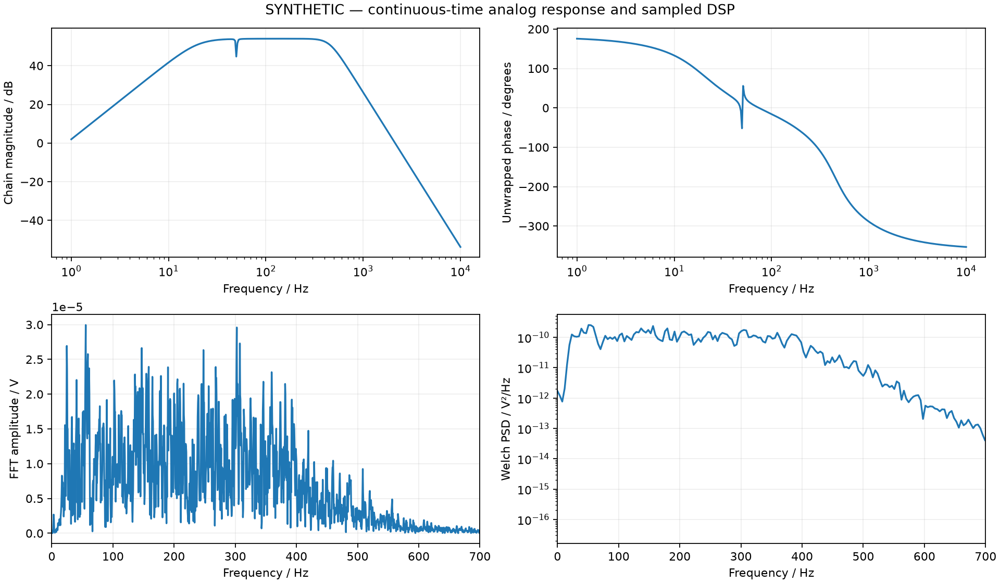
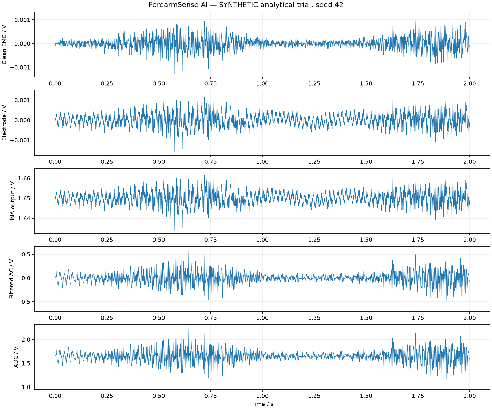
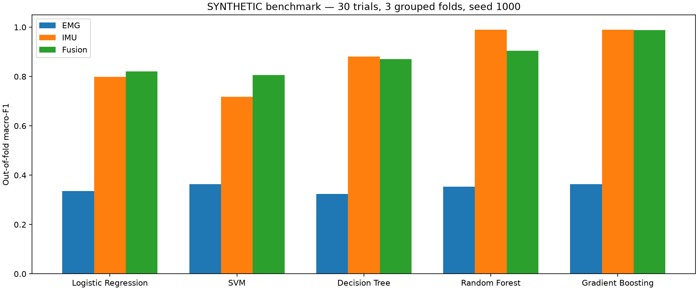

# Original report template - available-hardware revision

The PDF preserves the original cover, typography, front matter and 28-page academic structure.

# ABSTRACT

Non-invasive interpretation of forearm muscle electrical activity and hand movement is an instrumentation problem requiring correct analog conditioning, sampling and timing. Surface electromyography (sEMG) describes activation, while an inertial sensor provides movement context. Neither channel directly measures grip force or establishes a medical diagnosis.

This revised Project-Based Learning report presents ForearmSense AI using the available Arduino Uno, BioAmp EXG Pill, MPU-6050 and hand gripper. The single-channel BioAmp supplies the physical analog front end, the Uno acquires and communicates data, and the MPU-6050 supplies acceleration and angular-rate observations. A proposed 35-second grip/rest protocol supports activation timing, repetition consistency and movement-stability analysis through the existing local FastAPI/React application.

The current repository implements a synthetic signal laboratory with analytical conditioning, digital processing and trial-grouped gesture benchmarks. Its saved numerical artifacts are retained as simulation evidence. Live serial acquisition, recording, replay and human validation remain planned. The custom INA826/OPA2376 chain is retained as an educational design study, not identified as the physical BioAmp circuit.

The Uno revision and actual firmware require verification. Classic Uno/R3 10-bit operation is a provisional baseline. Approximately 250 Hz output described in the earlier PRD cannot preserve a 20-450 Hz EMG spectrum; initial live scope therefore emphasizes envelope/activity and low-frequency motion. No working optical pulse sensor is confirmed. Measured heart rate, SpO2, blood flow, pulse transit time and grip force are unavailable.

**Index Terms** - Surface EMG, BioAmp EXG Pill, Arduino Uno, MPU-6050, Analog Front End, Sampling, Envelope Extraction, Grip Activity, Motion Stability, Synthetic Verification.

# LIST OF FIGURES

| Figure | Title and description | Page |
| Figure 1 | Fixed-hardware EMG / motion data path | 8 |
| Figure 2 | Explicit LIVE, REPLAY and SIMULATION sources | 8 |
| Figure 3 | Saved synthetic frequency-analysis illustration | 14 |
| Figure 4 | Saved synthetic EMG conditioning example | 18 |
| Figure 5 | Saved synthetic model-comparison chart | 20 |
| Table | Title / scope | Page |
| Table 1 | Available-hardware subsystem specifications | 9 |
| Table 2 | Analog/ADC model and hardware boundary | 11 |
| Table 3 | Gain and headroom interpretation | 11 |
| Table 4 | Analog/digital filter responsibilities | 12 |
| Table 5 | Sampling, bandwidth and throughput | 13 |
| Table 6 | DSP feature definitions and units | 17 |
| Table 7 | Saved synthetic RF benchmark | 20 |
| Table 8 | Master experiment and evidence matrix | 21 |
| Table 9 | Engineering risks and mitigations | 26 |
| Table 10 | Verification and validation evidence | 26 |
| Table 11 | Multidisciplinary traceability | 7 |

# TABLE OF CONTENTS

- Page 5: 1. INTRODUCTION
- Page 6: 1.3 Measurable Engineering Objectives
- Page 7: 1.6 Course Outcome Integration and Multidisciplinary Traceability
- Page 8: 2. METHODOLOGY
- Page 9: 2.1 Hardware Subsystems and Acquisition Responsibilities
- Page 10: 2.3 Instrumentation Amplifier, Gain and Reference Analysis
- Page 11: 2.3.2 Analog Parameters and Prototype Traceability
- Page 12: 2.4 Analog Filter Design and Anti-Aliasing Analysis
- Page 13: 2.4.2 Sampling, Alias Zones and Serial Throughput
- Page 14: 2.4.3 Saved Educational Filter and Spectrum Illustration
- Page 15: 2.5 Operational Amplifier Analysis and Device Selection
- Page 16: 2.7 Six-Axis IMU Integration and Timing
- Page 17: 2.9 Digital Signal Processing Mathematical Framework
- Page 18: 2.9.2 Time-Domain Synthetic Signal Example
- Page 19: 2.10 Machine Learning Pipeline and Local Software
- Page 20: 2.10.1 Synthetic ML Evaluation and Leakage Boundaries
- Page 21: 3. EXPERIMENTS - SIMULATIONS AND HARDWARE PLAN
- Page 22: 3.1-3.4 Signal, Amplifier and Filter Experiments
- Page 23: 3.5-3.8 Noise, Sampling and DSP Experiments
- Page 24: 3.9-3.12 Motion, Optical, ML and Hardware Experiments
- Page 25: 4. RESULTS - ANALYTICAL, SIMULATED AND PLANNED
- Page 26: 4.4 Risk Analysis and Verification and Validation
- Page 27: 5. CONCLUSION AND FUTURE WORK
- Page 28: 6. REFERENCES

# 1. INTRODUCTION

### 1.1 Background

Surface electrodes detect voltage differences associated with the combined electrical activity of muscle fibres. A biopotential front end conditions this signal for an analog-to-digital converter. During a grip task, the measured amplitude depends on recruitment, electrode position, skin contact, anatomy, noise and acquisition settings. It is not a direct force reading [1, 2].

Inertial observations add context. A high EMG envelope with low angular motion may describe a steady contraction, while a similar envelope accompanied by substantial angular rate describes contraction with movement. Combining these channels supports an engineering study of task execution without claiming disease detection or clinical assessment.

### 1.2 Problem statement

The original academic architecture requires a custom dual-channel amplifier, STM32 acquisition and optical PPG sensing that are not the available hardware. The revised problem is to implement an honest, reproducible EMG-and-motion workflow using the existing Uno, one BioAmp channel, MPU-6050 and gripper, while retaining useful analog and DSP study from the simulation laboratory.

# 1.3 Measurable Engineering Objectives

- Document the actual acquisition chain, units, ADC settings, sensor configuration and serial protocol before presenting live measurements.
- Detect rest and contraction intervals and summarize envelope amplitude, activation timing, repetitions and within-session consistency.
- Describe hand movement and steadiness using verified acceleration and angular-rate channels.
- Record source-labelled sessions and support timestamp-based replay and export in the planned implementation.
- Retain analytical conditioning, DSP and synthetic ML experiments with their limitations clearly stated.
- Separate measured observations, saved simulation outputs, theoretical calculations and future targets throughout the report.

### 1.4 Scope, Operational Boundaries and Non-Clinical Limitations

The design uses existing hardware without requiring a replacement board, additional optical sensor, custom amplifier or new PCB. Its live-data target is activation and movement analysis. Current inspected application behavior is synthetic; the addition of serial acquisition and session tools remains proposed.

Real grip force, calibrated muscle strength, clinical fatigue, blood flow, oxygen saturation and disease detection are outside the supported measurement scope. A hand gripper is a task accessory rather than a dynamometer. A single BioAmp channel cannot establish agonist-antagonist co-activation.

The original Due/STM32 descriptions conflict with the user-confirmed Uno. Source-document instructions to adopt Streamlit, Electron, paid LLMs or scripted performance values are planning context, not current requirements. The existing FastAPI/React structure is retained.

### 1.5 Evidence Classification

Confirmed inventory identifies available components, not a working calibrated stream. Existing software identifies inspected repository behavior. Saved simulation values come from retained artifacts and were not regenerated for this report. Planned experiments have no reported physical outcome.

# 1.6 Course Outcome Integration and Multidisciplinary Traceability

The revised project preserves the original report's electronics, signal-processing and computational emphasis while aligning implementation with the available modules. No institutional assessment weighting is invented.

@TABLE 11: MULTIDISCIPLINARY COURSE OUTCOME AND IMPLEMENTATION TRACEABILITY
| Domain | Engineering activity | Evidence and boundary |
| AECD: differential sensing | Explain electrode voltage, common-mode rejection, bias and gain | Physical BioAmp role; exact configuration pending |
| AECD: amplifier analysis | Study gain, headroom, noise and reference centering | Custom chain remains analytical, not module calibration |
| AECD: active filters | Compare high-pass, notch and low-pass functions | Educational model; no inferred BioAmp response |
| DSP: sampling | Explain Nyquist, aliasing, rate reduction and serial capacity | Live rate follows verified firmware |
| DSP: features | RMS, MAV, envelope, task timing and motion summaries | Synthetic implementation; live contract planned |
| ML: evaluation | Compare EMG, IMU and fusion with grouped splits | Saved synthetic benchmark only |
| Software integration | Validate inputs, label sources, record sessions and replay | Existing simulation API; acquisition tools planned |
| Verification | Separate analytical, synthetic and measured outcomes | No physical calibration or human validation claimed |

### Academic contribution

The central engineering decision is to match analysis to the actual measurement chain. A high-rate simulator and a low-rate Uno stream cannot share physical-performance claims merely because both display an EMG-like waveform. Documenting this boundary is part of instrumentation design.

# 2. METHODOLOGY

### 2.1 Overall Multimodal System Architecture

The physical design has two sensing pathways: a BioAmp EMG output acquired by the Uno ADC, and MPU-6050 acceleration/gyro data read over the existing configured interface. The laptop receives serial data and performs proposed session analysis. There is no working optical channel in the confirmed inventory.

[Functional diagram in the PDF; live, replay and simulation sources remain explicit.]

@Figure 1: Fixed-hardware functional data path. This is a block diagram, not a verified pin-level wiring diagram.

The BioAmp performs physical analog conditioning. The existing INA826/OPA2376 model remains an independent teaching and analysis tool; it does not convert live BioAmp counts. Units, timing and available fields must follow the actual sketch and module settings.

[Functional diagram in the PDF; live, replay and simulation sources remain explicit.]

@Figure 2: Three explicit data sources. A disconnect does not automatically switch LIVE to SIMULATION.

The confirmed inventory is Uno, BioAmp EXG Pill, MPU-6050 and gripper. The Uno revision is not specified, so the report uses classic R3 ADC behavior only as a provisional example. No replacement sensor, custom cuff or battery power tree is required by this design.

# 2.1 Hardware Subsystems and Acquisition Responsibilities

@TABLE 1: AVAILABLE-HARDWARE SUBSYSTEMS, INTERFACES AND MEASUREMENT BOUNDARIES
| Subsystem | Available component | Responsibility / limitation |
| sEMG front end | BioAmp EXG Pill + existing electrodes | One analog channel; gain, bandpass and output range require confirmation |
| Acquisition controller | Arduino Uno | ADC, timing and serial transport; revision/reference/resolution unverified |
| Motion sensing | MPU-6050 | Acceleration + gyro; ranges/rate and mounting require confirmation |
| Mechanical task | Hand gripper | Grip/release cue; no measured force |
| Processing and UI | Laptop, FastAPI and React | Existing local synthetic lab; live tools planned |
| Optical sensing | No working sensor | Measured HR/SpO2 unavailable; simulation only |
| Optional event input | Existing trigger or manual buttons | Operator annotations, not health measurements |

### 2.2 Forearm Surface EMG Acquisition and Skin-Electrode Interface

Surface electrodes detect differences in electrical potential associated with muscle activity. Placement, skin contact, reference arrangement, motion and interference affect the recorded amplitude [1, 2]. The module output represents a conditioned signal, not a direct force value.

The actual electrode arrangement and module revision must be documented. No unverified pin assignment, supply compatibility or solder modification is prescribed. A separate hardware review is necessary before participant-connected acquisition; a USB cable does not establish electrical isolation.

The manufacturer's BioAmp documentation describes one configurable channel [3]. Therefore the two-channel co-activation analysis and dual-channel feature assumptions in the original theoretical design are not presented as physical capabilities.

# 2.3 Instrumentation Amplifier, Gain and Reference Analysis

### BioAmp as the physical front end

The manufacturer identifies the BioAmp EXG Pill as a single-channel, configurable analog front end [3]. The actual revision, gain/bandpass configuration, electrode arrangement, output range and interface compatibility must be recorded before voltage interpretation. The report does not prescribe solder changes or substitute a guessed circuit for the existing module.

Represent the conditioned output conceptually as y(t) = Vbias + G x(t) + n(t), followed by output limits. This model explains reference centering, gain and clipping. It does not identify the module's actual transfer function. Nominal or theoretical values cannot establish common-mode rejection, input-referred noise or anti-alias attenuation of the assembled setup.

### ADC conversion and quantization

For a unipolar ADC using an endpoint mapping, Vout approximately equals code x Vref / (2^B - 1). Counts are the initial measured unit; volts require the configured resolution and verified reference. Input-referred EMG voltage additionally requires validated gain and frequency response.

For the provisional classic Uno/R3 case, B = 10 gives codes 0-1023. If Vref were exactly 5.000 V, endpoint spacing would be 5/1023 = 4.8876 mV per count. The ideal quantizer bin width is commonly expressed as 5/1024 = 4.8828 mV. These are conditional calculations, not measurements of the board reference or effective resolution. An Uno R4 has different ADC capabilities [4, 5]; the actual board must be identified.

# 2.3.2 Analog Parameters and Prototype Traceability

@TABLE 2: ANALOG AND ADC PARAMETERS - MODEL VERSUS PHYSICAL PROTOTYPE
| Parameter | Educational model / calculation | Physical Uno/BioAmp status |
| AFE topology | Ideal INA/filter/post-gain stages | BioAmp circuit configuration unverified |
| First-stage gain | 1 + 49400/5490 = approx. 9.998 | Not adopted as BioAmp gain |
| Reference voltage | 1.65 V model reference | Actual bias/reference to be measured |
| ADC | 12-bit, 3.3 V simulated conversion | Uno revision/configuration pending |
| Classic R3 example | 5/1023 = 4.8876 mV endpoint spacing | Conditional on exactly 5.000 V reference |
| Input-referred volts | Model output divided by nominal gain | Unavailable without verified gain/response |
| Noise and CMRR | Analytical/simulation study | No physical values reported |

@TABLE 3: GAIN AND HEADROOM INTERPRETATION
| Quantity | Meaning | Correct use |
| Differential input | Voltage difference between electrode inputs | Explain sensing; no assumed force conversion |
| Bias/reference | Centers signal within ADC range | Verify actual level and clipping margins |
| Gain | Amplifies useful signal and some disturbances | Use measured/configured value only |
| Output limits | Restrict linear swing | Count actual rail events with known ADC bounds |
| Baseline subtraction | Removes estimated DC level digitally | Cannot undo analog saturation or restore aliased data |

The original report's custom gain split, headroom and noise calculations remain educational material. Substituting the BioAmp name into those numerical specifications would misrepresent the available hardware.

# 2.4 Analog Filter Design and Anti-Aliasing Analysis

### 2.4.1 High-Pass, Notch and Low-Pass Responsibilities

High-pass conditioning limits slowly varying offsets, a notch can reduce narrowband mains interference, and an analog low-pass limits out-of-band energy before acquisition. These functions are conceptually distinct from the moving-average envelope filter. Exact BioAmp transfer characteristics depend on its configured hardware [3].

For an ideal Butterworth low-pass of order n, magnitude is |H(f)| = 1 / sqrt(1 + (f/fc)^(2n)). This analytical response explains roll-off; it does not establish an assembled module's attenuation, tolerance sensitivity or phase response.

The educational analog model uses a second-order high-pass, optional 50 Hz notch and fourth-order low-pass. It is a mathematical conditioning chain, not a manufacturer-validated BioAmp circuit. Its assumed 450 Hz cutoff cannot be transferred to a low-rate physical stream as evidence of a preserved 450 Hz bandwidth.

@TABLE 4: ANALOG AND DIGITAL FILTER RESPONSIBILITIES
| Stage | Purpose | Verification requirement |
| Physical BioAmp filtering | Condition the analog electrode signal | Identify module revision/configuration and characterize response |
| Pre-ADC anti-alias filtering | Suppress input frequencies that would fold into baseband | Verify against the actual acquisition rate |
| Firmware baseline estimator | Remove estimated bias from samples | Inspect sketch, arithmetic and initialization |
| Rectification / envelope smoothing | Summarize activation amplitude | Preserve internal rate and window length |
| Digital rate reduction | Lower stored/output rate | Filter raw data appropriately before decimation |
| Offline spectral processing | Estimate frequency content | Requires adequate original sampling and anti-alias evidence |

No digital filter can undo aliasing already introduced by the ADC. Software smoothing after acquisition cannot prove analog anti-alias performance.

# 2.4.2 Sampling, Alias Zones and Serial Throughput

### Acquisition rate is not display rate

The earlier PRD describes approximately 500 internal samples/s with every second sample printed, giving approximately 250 output samples/s. Another guide describes approximately 200 packets/s. Neither rate has been verified on the user's Uno. The actual sketch, device timestamps, measured throughput and packet format determine usable analysis.

@TABLE 5: SAMPLING, BANDWIDTH AND THROUGHPUT
| Condition | Engineering consequence |
| 250 Hz raw output | Nyquist frequency is 125 Hz; a 20-450 Hz signal cannot be preserved. |
| 500 Hz internal acquisition | Nyquist frequency is 250 Hz; still insufficient for the full proposed 450 Hz band. |
| Keeping alternate raw samples | Requires suitable pre-decimation filtering; envelope smoothing alone does not prove raw-signal anti-alias protection. |
| Existing 4 kHz simulation | Supports theoretical multirate study; does not establish a physical Uno acquisition rate. |
| 10 Hz plot redraw | UI refresh rate only; should not discard incoming samples from the recording. |

### Serial capacity

At 115200 baud with 8N1 UART framing, nominal capacity is 115200/10 = 11,520 bytes/s before design headroom. A 70-byte text line at 200 Hz requires 14,000 bytes/s and exceeds this capacity. Actual packet lengths, line endings, IMU traffic and firmware processing must be measured. No verbose 4 kHz ASCII stream is promised.

The initial plan preserves the existing firmware and focuses on envelope/activity interpretation. A 50-100 Hz IMU stream is a proposed target for grip motion and low-frequency tremor activity, conditional on measured transport capacity. It is not a verified configured rate.

### Timing and missing data

Store device time where supplied and host receipt time separately. Host timestamps in the legacy text format are approximate transport timing. Estimate actual rate, detect gaps and handle counter rollover/reset. Without packet sequence numbers, report timing gaps rather than an exact lost-packet count. Do not derive acceleration across long gaps or session resets.

### Scope consequence

The initial live design excludes full-band EMG median-frequency fatigue inference. Increasing a plotting rate or interpolating a trace cannot restore aliased information. The existing simulator's decimation-to-1-kHz path must not be called on a 250 Hz physical stream.

# 2.4.3 Saved Educational Filter and Spectrum Illustration

@Figure 3: Existing saved synthetic frequency-analysis plot. This is an educational artifact, not a spectrum measured from the available Uno/BioAmp setup.

The figure illustrates spectral analysis of generated signals and the effect of modelled processing. It does not establish physical bandwidth, anti-alias attenuation, line-interference rejection or a human fatigue response. Spectral features from a 250 Hz output stream cannot be interpreted as full-band 20-450 Hz EMG features.

### Numerical versus hardware evidence

The repository contains independent candidate/ideal SPICE checks and analytical calculations. Existing verification notes report partial verification because an INA826 compatibility case failed the expected-gain check. No solver was rerun for this revision, and no full BioAmp device-chain characterization is claimed.

# 2.5 Operational Amplifier Analysis and Device Selection

The original report compared discrete instrumentation amplifiers and operational amplifiers for a theoretical custom AFE. That comparison remains an AECD study rather than a procurement requirement. The available BioAmp front end is retained; no INA826, OPA2376, OPA2333 or LM741 purchase/replacement is required.

Closed-loop bandwidth, slew rate, input/output headroom, noise and supply compatibility explain why a selected op amp must suit its operating point. For a sinusoid, required slew rate is at least 2 pi f Vpeak. This relation is theoretical; it does not certify the uncharacterized module.

### 2.6 Power Supply and Electrical-Safety Framework

The proposed implementation uses the existing board/module arrangement. Its actual supply rails, board regulators, logic levels, reference connections and interface compatibility must be inspected. The original multi-rail Li-Po/LDO design and battery-runtime estimates do not describe a demonstrated power system.

The hand-connected electrode setup requires qualified review against exact manufacturer instructions and the institution's applicable safety/ethics requirements. USB functionality, a stable chart or successful software tests does not establish isolation, safe leakage or clinical approval. This report supplies no invented wiring map or certification.

@TABLE: POWER AND IMPLEMENTATION BOUNDARIES
| Original theoretical item | Revised treatment |
| Custom 3.3 V / 1.8 V power tree | Not required by the available-hardware design |
| Optical LED/core supply | No working optical sensor in the confirmed setup |
| Estimated wearable runtime | No measured battery/runtime result |
| MCU and module logic levels | Verify exact boards before connection changes |
| Electrical safety | Separate hardware-review dependency |

The simulation and replay workflow can be evaluated without a participant. Human recordings remain conditional on verification of the existing setup.

# 2.7 Six-Axis IMU Integration and Timing

### What the MPU-6050 measures

The MPU-6050 integrates an accelerometer and gyroscope [6]. Roll/pitch estimates are derived quantities; the sensor does not directly measure Euler angles. Acceleration includes gravity and movement. Raw counts require the configured sensitivity/range before conversion to g, m/s^2 or degrees/s. The report's earlier +/-4 g and +/-500 degrees/s settings are not assumed to be the physical module configuration.

### Bias and orientation

Use stationary data to estimate gyro offset. If correctly scaled acceleration and gyro channels exist, a complementary filter can estimate tilt: theta[k] = a(theta[k-1] + omega[k] dt) + (1-a) theta_acc[k]. The coefficient depends on sample timing and the desired crossover. The simulator's a = 0.98 is not a universal calibration constant.

Dynamic acceleration disturbs gravity-based tilt. Integrated yaw drifts because a six-axis sensor lacks a heading reference. Display relative yaw only with its drift limitation, and prefer angular-rate features for steadiness. No magnetometer or absolute compass heading is claimed.

### 2.8 Optical PPG Architecture and Measurement Boundary

The original academic report proposes MAX30102 sensing, while the earlier PRD describes a failed MAX30100 and simulated HR. The user confirmed no working optical sensor. Neither guide establishes a measured pulse channel for this prototype.

Measured heart rate, SpO2, blood-flow speed and pulse transit time are unavailable. Optional generated PPG remains explicitly simulated and excluded from live scores, real-data features and physiological conclusions. No clinical threshold is applied to a generated heart-rate trace.

Prefer measured gyro rate for steadiness. Angular acceleration is the rate change divided by valid device-time difference; angular jerk is its derivative, not the second angle derivative. Suppress derivatives at gaps. Tremor-band activity is descriptive rather than diagnostic.

# 2.9 Digital Signal Processing Mathematical Framework

### Baseline and envelope

The earlier PRD describes the following firmware behavior. Its exact startup state, arithmetic and sample rate must be checked against the actual sketch before asserting equivalence:

1. b[n] = 0.995 b[n-1] + 0.005 x[n]
2. c[n] = x[n] - b[n]
3. r[n] = abs(c[n])
4. e[n] = 3 x mean of the latest 50 rectified samples

A 50-sample window is 100 ms at 500 Hz. It does not become a 200 ms firmware window merely because every second result is transmitted. Store a received firmware envelope separately from any host-recomputed envelope. Do not filter an already processed envelope again and call it the same measurement.

### Feature definitions

@TABLE 6: DSP FEATURE DEFINITIONS AND UNITS
| Quantity | Definition and interpretation |
| RMS | sqrt(mean(c[n]^2)); amplitude summary in counts unless voltage is verified. |
| MAV | mean(abs(c[n])); average rectified amplitude. |
| Envelope CV | standard deviation(e)/mean(e), only during valid active holds with a non-negligible denominator. |
| Activation duration | Sum of valid intervals above a calibrated activity threshold. |
| Repetitions | Qualified rest-to-active transitions with hysteresis and a minimum duration. |
| Squeeze/rest contrast | Active versus baseline amplitude; undefined if the reference denominator is inadequate. |

### Reference and segmentation

Record a quiet baseline and a comfortable reference contraction. Estimate activity thresholds from observed baseline noise, use hysteresis to avoid repeated crossings, and freeze thresholds during a hold. Document threshold constants and calibration conditions in session metadata. A reference-normalized envelope is a within-session percentage, not percent maximum voluntary contraction without an actual MVC protocol.

### Task Protocol

Rest 0-5 s; squeeze 5-10 s; rest 10-15 s; squeeze 15-20 s; rest 20-25 s; squeeze 25-30 s; rest 30-35 s. Use comfortable holds, declare calibration on hold one, and compare holds two and three without changing thresholds retrospectively.

# 2.9.2 Time-Domain Synthetic Signal Example

@Figure 4: Existing saved synthetic EMG signal chain, seed 42. Generated muscle-like activity, injected corruption and modelled conditioning are educational examples; none is a physical Uno recording.

The original source plot is retained without modifying its numerical traces. It supports discussion of bias, gain and filtering under the simulator's configuration. It cannot establish the actual module gain, electrode voltage, calibrated force, noise floor or response to real gripping.

Compare mean envelope, hold-to-hold variability and activation duration within the same setup. Electrode relocation or gain changes invalidate direct amplitude comparison across sessions unless accounted for. A falling envelope is an activation change; it does not demonstrate glycogen depletion, loss of grip force or a clinical fatigue state. Spectral fatigue features remain an educational simulation topic until acquisition bandwidth and study conditions support them.

# 2.10 Machine Learning Pipeline and Local Software

### Existing synthetic pipeline

The repository builds synthetic Rest, Grip, Wrist flexion, Wrist extension and Forearm rotation trials. It aligns seven EMG and eight IMU features in 200 ms windows with 50% overlap. Existing models include Logistic Regression, SVM, Decision Tree, Random Forest and Gradient Boosting. Trial-grouped outer evaluation and nested grouped SVM calibration reduce trial leakage within this synthetic benchmark.

Programmed motion trajectories make several classes easy to distinguish. High synthetic accuracy cannot establish human gesture recognition, placement robustness or generalization to a physical Uno stream. The existing model should not be relabelled as a clinically validated live grip-quality predictor.

### Initial feedback

The first live milestone reports measured features and quality per hold. It does not require XGBoost, TreeSHAP or a 51-feature contract. These are claims/design choices from another project plan, not dependencies of this implementation. Keep the smaller existing pipeline and add real-data learning only when the task and labels justify it.

### Local Application Architecture

The existing FastAPI/React laboratory remains the implementation base. The proposed live extension adds validated serial input and source-labelled session tools; no second Streamlit/Electron stack or paid API is required. The actual legacy formats differ: one supplies raw/envelope only, while another includes timestamps and orientation/gyro. Missing channels must remain unavailable.

Planned archives retain raw samples, events, configuration and quality flags. A disconnect marks values stale and never silently starts simulation. Session review/replay is a proposed addition, not an already verified capability.

# 2.10.1 Synthetic ML Evaluation and Leakage Boundaries

@TABLE 7: SAVED SYNTHETIC RANDOM FOREST BENCHMARK - NOT HUMAN PERFORMANCE
- Random Forest EMG: accuracy 35.09%, macro-F1 0.3532
- Random Forest IMU: accuracy 98.95%, macro-F1 0.9895
- Random Forest Fusion: accuracy 90.53%, macro-F1 0.9050

@Figure 5: Existing saved synthetic model-comparison chart. Programmed motion trajectories strongly affect accuracy; these results do not validate the physical prototype.

Collect independent task labels and record session and participant identifiers for grouping, not as predictors. Hold all windows of one session together. When claiming new-person performance, hold participants out as well: session grouping alone can still mix one participant across training and validation. Fit preprocessing only on training folds and compare against a simple baseline.

GOOD/BAD triggers describe operator-selected scenarios. They are not diagnostic ground truth. Exclude event labels, timestamps, participant/session identifiers, simulated HR and synthetic optical values from predictors. Do not train a model to reproduce a hand-written score and then claim it independently validates that score.

# 3. EXPERIMENTS - SIMULATIONS AND HARDWARE PLAN

The experimental matrix retains the original report's signal, analog, DSP, IMU and ML topics while changing their evidence status to match the available hardware. Saved artifacts are not newly executed measurements. Tests for the proposed live path remain to be implemented and run.

@TABLE 8: MASTER EXPERIMENTAL MATRIX - DOMAIN AND CURRENT EVIDENCE STATUS
| Exp. | Domain / investigation | Evidence status |
| --- | --- | --- |
| 1 | sEMG signal synthesis | Existing synthetic artifact |
| 2 | Gain, reference and headroom | Analytical model; BioAmp calibration pending |
| 3 | High-pass / low-pass response | Existing model; module response unmeasured |
| 4 | Mains interference and notch | Simulation study; hardware check pending |
| 5 | Noise, offset and clipping | Simulation study; physical characterization pending |
| 6 | ADC sampling and transport | Theory available; Uno timing pending |
| 7 | FIR / IIR and envelope processing | Existing educational DSP; firmware match pending |
| 8 | Features and task segmentation | Synthetic features; real task checks pending |
| 9 | MPU-6050 motion / orientation | Synthetic scenarios; hardware calibration pending |
| 10 | Optical channel boundary | Simulated only; no working pulse sensor |
| 11 | Gesture ML evaluation | Saved synthetic benchmark; no human validation |
| 12 | Recording and hardware verification | Planned; no completion claim |

No fabricated PASS result, acquisition transcript, live screenshot, clinical score or board-performance number is introduced. Existing educational computations and proposed physical checks are separated below.

# 3.1-3.4 Signal, Amplifier and Filter Experiments

### 3.1 Experiment 1: sEMG Source and Signal Synthesis

Aim: examine generated activation and interference using a declared seed and configuration. Existing saved seed-42 artifacts provide a reproducible numerical example. They do not model every motor-unit, electrode or subject effect. Status: saved synthetic evidence; not rerun in this report revision.

### 3.2 Experiment 2: Gain, Bias and Headroom

Aim: explain the relationship between amplification, reference centering and clipping. Existing analog code models a custom chain. For hardware, document BioAmp configuration, measure ADC reference and characterize input/output behavior with suitable bench instrumentation before interpreting input-referred voltage. Status: analytical model available; physical calibration pending.

### 3.3 Experiment 3: High-Pass and Low-Pass Response

Aim: distinguish theoretical response from the module's actual bandwidth. Use the existing educational response calculation and, separately, characterize the configured module if hardware evidence is required. Do not assume the original 20.28-452.7 Hz custom response applies to the BioAmp. Status: model study retained; module response unmeasured.

### 3.4 Experiment 4: Mains Hum and Notch Processing

Aim: assess response to known simulated hum and discuss differential interference rejection. Apply a declared interference amplitude and inspect resulting spectral/quality changes in the educational model. A simulated notch benefit does not establish physical CMRR or guarantee elimination of differential mains pickup. Status: simulation topic; real interference characterization pending.

Each future physical result must include actual configuration, instrument/method, units, sample timing and retained raw data. The result chapter must not reuse target specifications as measurements.

# 3.5-3.8 Noise, Sampling and DSP Experiments

### 3.5 Experiment 5: Noise, Offset and Clipping

Aim: examine baseline instability and saturation under known simulated disturbances. Existing configurable simulations illustrate these effects. For physical recordings, record baseline dispersion and observed rail events with a known ADC range. A low-quality trace does not identify a unique cause. Status: simulated study; assembled-system noise not measured.

### 3.6 Experiment 6: ADC Rate, Aliasing and Transport

Aim: measure actual Uno throughput and assess usable bandwidth. Inspect the sketch, line lengths, timestamps, rollover and gaps. Verify aggregate traffic against the 115200-baud UART budget. The approximately 250 Hz legacy output cannot retain a 450 Hz band. Status: sampling theory available; Uno timing/anti-alias evidence pending.

### 3.7 Experiment 7: Envelope and FIR/IIR Analysis

Aim: preserve the exact firmware baseline/rectification/moving-average semantics where confirmed. Compare against an independent numerical implementation using the actual internal rate and startup conditions. Retain the existing high-rate FIR/IIR analysis as educational work. Status: current synthetic DSP exists; physical firmware equivalence unverified.

### 3.8 Experiment 8: Features and Task Segmentation

Aim: check known-signal RMS/MAV and task-state transitions, including near-zero denominators, gaps and incomplete holds. Apply the 35-second task and compare held-out holds only after calibration is frozen. Envelope changes describe activation changes, not force loss or diagnosed fatigue. Status: synthetic features exist; real-task repeatability pending.

Evidence must distinguish numerical correctness from physical interpretation. A parser test can show rejected malformed lines; it cannot prove sensor accuracy. A sine-wave RMS check validates calculation, not human physiological performance.

# 3.9-3.12 Motion, Optical, ML and Hardware Experiments

### 3.9 Experiment 9: IMU Orientation and Tremor-Like Motion

Aim: characterize stationary bias, configured scales and movement response. Prefer gyro rate for steadiness, and use gravity-referenced tilt only under suitable motion conditions. Relative yaw drifts. Simulated motion scenarios are available; no measured pitch RMSE or tremor diagnosis is reported.

### 3.10 Experiment 10: Optical Channel Boundary

Aim: demonstrate source transparency. Generated PPG can illustrate peak detection, but no working pulse sensor exists in the confirmed setup. Real HR and SpO2 remain unavailable rather than zero or substituted demo values. Status: educational simulation only.

### 3.11 Experiment 11: Grouped Gesture Benchmark

Aim: compare models and modalities on saved synthetic trials. The current legacy artifact records seed 1000, 30 trials, 570 windows and three-fold grouped evaluation, rather than the original PDF's different five-fold experiment. Status: saved synthetic benchmark; no independent real-data performance claim.

### 3.12 Experiment 12: Real Acquisition, Recording and Replay

Aim: establish the actual serial contract, source-labelled plotting, interruption handling and timestamp-faithful review. Reject malformed/nonfinite packets, record configuration and preserve unavailable fields. Document a physical-input response and repeatability only after suitable hardware review. Status: planned.

### Real-Data Validation Rule

Independent stochastic EMG realizations need not correlate sample-for-sample. Compare task-aligned envelopes, distributions and timing using separate calibration/evaluation holds. Fault injection checks software behavior on a known simulated input; it does not validate diagnosis of a physical fault.

# 4. RESULTS - ANALYTICAL, SIMULATED AND PLANNED

### 4.1 Saved Numerical Evidence

Values below were read from existing results/metrics/summary.json, not generated by a new experiment: seed 42, two-second duration, 4000 simulated samples/s and 8000 samples. All voltages are under simulator assumptions, not a calibrated BioAmp/Uno conversion.

{
  "rms_v": 0.00022625104216873095,
  "mav_v": 0.00016119507586601775,
  "waveform_length_v": 0.4830194102490696,
  "zero_crossings": 937,
  "slope_sign_changes": 556,
  "mean_frequency_hz": 211.73621990535875,
  "median_frequency_hz": 203.125
}

### 4.2 Synthetic ML Results

The saved Random Forest accuracy is 35.09% for EMG, 98.95% for IMU and 90.53% for fusion. Thus fusion is not automatically superior in this programmed dataset. Evaluation is window-level with trial grouping, not participant validation. Bootstrap intervals condition on fixed fits and do not provide clinical confidence bounds.

### 4.3 Physical Results and Source Reconciliation

No actual Uno transcript, calibrated force reference or human dataset was supplied. No live hardware measurement or clinical result is reported. The original guides' MAE, R-squared, latency, model size and checked test counts are not adopted as current evidence.

Original STM32/custom-AFE/MAX30102 assumptions are replaced by Uno/BioAmp/MPU-6050. Dual EMG, optical physiology, a fabricated cuff, a custom battery runtime and calibrated grip force are not demonstrated. The original report's numerical custom-AFE and five-fold ML claims remain historical theoretical/simulation material rather than results of this physical setup.

# 4.4 Risk Analysis and Verification and Validation

@TABLE 9: ENGINEERING RISKS AND EVIDENCE-BASED MITIGATIONS
| Risk | Required treatment |
| Unknown board/ADC configuration | Confirm Uno revision, resolution/reference and firmware before converting counts |
| Aliasing or serial saturation | Verify rate, bandwidth, packet length and transport headroom |
| Missing data and stale display | Preserve timestamps, detect gaps/resets and show disconnected state |
| Electrode/movement contamination | Report observable quality; no unverified fault diagnosis |
| Source confusion | Explicit LIVE / REPLAY / SIMULATION labels in plots and exports |
| Overstated physiology | No force, SpO2, blood-flow or clinical-fatigue claims |
| Dataset leakage | Group sessions; hold participants out for new-person claims |

@TABLE 10: VERIFICATION AND VALIDATION ACCEPTANCE EVIDENCE
| Capability | Evidence required | Current status |
| Acquisition | Actual packets and documented configuration | Pending |
| Units/timing | ADC/IMU scales, timestamps and reset/gap handling | Pending |
| Task repeatability | Retained raw sessions, frozen calibration, held-out holds | Pending |
| Record/replay | Complete metadata and timing agreement | Planned |
| Numerical examples | Existing seeded artifacts with provenance | Saved simulation |
| Real classification | Independent labels and grouped holdout | Not established |
| Electrical safety | Qualified hardware review of existing setup | Not established by software |

One EMG channel cannot separate multiple muscles. Host receive time is not exact acquisition time. No test result or simulated waveform certifies body-connected operation. The project remains educational and non-clinical.

# 5. CONCLUSION AND FUTURE WORK

ForearmSense AI is revised into a hardware-compatible EMG and motion-analysis project using the available Arduino Uno, BioAmp EXG Pill, MPU-6050 and hand gripper. Its core purpose is to observe grip-related muscle activation, rest/contraction timing, repeated-hold consistency and hand movement. The BioAmp supplies the physical analog channel; the Uno acquires data; the laptop provides processing and visualization. The design requires no replacement MCU, additional optical sensor or custom AFE construction.

The existing synthetic laboratory remains useful for teaching analog conditioning, spectral analysis, multirate processing and grouped ML evaluation. Saved artifacts provide numerical examples with explicit provenance. They do not validate real muscle physiology, the physical BioAmp transfer function, grip force or clinical performance. The report therefore distinguishes existing software, saved simulation results and proposed hardware verification.

The available hardware supports a credible, focused instrumentation project when its sampling, units, timing and quality limits are respected. No working optical pulse channel, dual EMG measurement, absolute heading or calibrated force measurement is claimed. The low-rate legacy serial design limits initial live EMG interpretation to activity/envelope observations pending acquisition verification.

### Implementation Roadmap

1. Identify the Uno revision, inspect the actual sketch, confirm BioAmp/MPU settings and capture the serial contract without changing working hardware.
2. Add validated serial ingestion, channel availability, source labels and visible disconnect/gap handling to the existing backend/frontend.
3. Add baseline calibration, the 35-second task, raw recording and timestamp-based review/replay.
4. Add only the measured EMG and motion features justified by actual units and bandwidth, with focused parser/numerical/session tests.
5. Evaluate repeatability on retained real sessions, then update the results chapter using measured outputs and documented conditions.
6. Consider real-data classification or an experimental consistency index only after independent labels and appropriate held-out data exist.

The revision preserves the original report template and title while correcting hardware responsibilities and evidence status throughout. Faculty-guide details remain the original editable placeholder. Physical calibration and live validation are future work, not unreported successes.

# 6. REFERENCES

### Technical references

[1] C. J. De Luca, "The use of surface electromyography in biomechanics," Journal of Applied Biomechanics, vol. 13, no. 2, pp. 135-163, 1997. DOI: 10.1123/jab.13.2.135. Background reference retained from the original report.

[2] R. Merletti et al., "Technology and instrumentation for detection and conditioning of the surface electromyographic signal: State of the art," Clinical Biomechanics, vol. 24, no. 2, pp. 121-134, 2009. DOI: 10.1016/j.clinbiomech.2008.08.006. Background reference retained from the original report.

[3] Upside Down Labs, BioAmp EXG Pill hardware documentation. https://docs.upsidedownlabs.tech/hardware/bioamp/bioamp-exg-pill/index.html . Manufacturer documentation for channel count and configurable front end; exact board configuration remains unverified.

[4] Arduino, "What's the difference between UNO R3 and UNO R4 boards?" https://support.arduino.cc/hc/en-us/articles/9350551575964-What-s-the-difference-between-UNO-R3-and-UNO-R4-boards . Distinguishes board families and ADC capability.

[5] Arduino, "UNO R4 Minima ADC Resolution." https://docs.arduino.cc/tutorials/uno-r4-minima/adc-resolution/ . Demonstrates why a generic Uno name does not establish configured ADC resolution.

[6] InvenSense, "MPU-6000 and MPU-6050 Product Specification," revision 3.4, 19 August 2013. https://product.tdk.com/system/files/dam/doc/product/sensor/mortion-inertial/imu/data_sheet/mpu-6000-datasheet1.pdf . Manufacturer specification for acceleration/gyro capability and configuration-dependent scaling.

### Supplied project documents

[7] PRENDO_PRD.md. Original firmware/filter and legacy serial description; simulated HR and failed MAX30100 account. Supplied by the project team.

[8] AIBOTS_2026_REVIEW_3_DEFENSE_GUIDE.md and AIBOTS 2026 GripSense Defense Guide.pdf. Earlier Due-based workflow and demonstration claims. Used as planning context; historical performance assertions not independently adopted.

[9] PRENDO_Sensor_Technical_Quick_Guide.pdf, 5 pages. Sensor capability boundaries; exact board models were unconfirmed in that document.

[10] ForearmSense_AI_AECD_PBL_FINAL_FORMATTED.pdf, 28 pages. Original theoretical custom-AFE/STM32/MAX30102 report. Preserved as the source manuscript, not evidence of that hardware being built.

### Repository evidence inspected for this revision

[11] results/metrics/summary.json and results/ml/metrics.json: saved synthetic numerical outputs quoted in Chapter 4. backend/app/: current API, schema, analog, simulation, DSP and ML implementation. docs/verification.md: historical software-verification records, not rerun for this revision. docs/fixed-hardware-project-map.md: user-confirmed inventory and revised implementation scope.