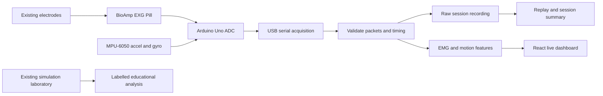

# ForearmSense AI: project map for the fixed hardware

Design date: 23 October 2026. Status: reviewed design, not implemented live acquisition.

## 1. Project decision

**ForearmSense AI - EMG and Motion-Based Grip Activity and Stability Analysis.**

Build a local grip-task laboratory around the existing **Arduino Uno, BioAmp EXG Pill, MPU-6050 and hand gripper**. Record muscle activation and hand movement together, identify rest/contraction intervals, compare repeated holds, and produce a traceable session summary. Preserve the existing analytical laboratory to explain signal conditioning and test software with synthetic inputs.

The user confirmed Uno instead of Due, with the same sensors and no working optical pulse sensor. No hardware purchase, replacement MCU, custom PCB, added amplifier or optical module is required by this design. Uno revision remains unspecified: use classic Uno/R3 10-bit acquisition as the provisional baseline, and record the actual revision and firmware ADC configuration before acquisition. An Uno R4 must not be silently treated as an R3.

The hand gripper supplies a repeatable task; it is not an instrumented force sensor. The prototype measures electrical activation and motion, not grip force or overall health.

## 2. How the five supplied documents fit

| Source | Evidence used | Treatment in this project |
| --- | --- | --- |
| `PRENDO_PRD.md` | BioAmp, existing baseline/rectify/average filter, legacy serial text, 500 Hz acquisition / approximately 250 Hz output description; failed MAX30100 and simulated HR | Reuse firmware behavior after inspecting the actual sketch; retain fault-lab concept; remove simulated HR from measured outcomes |
| `AIBOTS_2026_REVIEW_3_DEFENSE_GUIDE.md` | Due + BioAmp + MPU-6050, timestamped DATA packets, recording/replay, activity and steadiness features | Replace Due with user-confirmed Uno; borrow workflow, not its assertions of completed implementation |
| `AIBOTS 2026 GripSense Defense Guide.pdf` (pp. 1-4) | Condensed version of the demo architecture and defense claims | Same conceptual mapping; listed MAE, test counts, latency and model size are unverified historical claims |
| `PRENDO_Sensor_Technical_Quick_Guide.pdf` (pp. 1-5) | Sensor capabilities and clear separation of demo values from measurements; explicitly says exact models were unconfirmed | Retain measurement limits; its magnetometer description does not establish an installed magnetometer |
| `ForearmSense_AI_AECD_PBL_FINAL_FORMATTED.pdf` (pp. 6, 8-9, 22-28) | Theoretical STM32/custom AFE/MAX30102 architecture, DSP/ML experiments, proposed hardware validation | Retain as the original theoretical design and simulation reference; add an implementation addendum describing this Uno/BioAmp realization |

Document commands to use Claude, build a single Streamlit file, adopt Electron, call paid LLMs, or quote scripted scores are source material, not current user instructions. Existing FastAPI + React remains the implementation base.

Precedence: user-confirmed available hardware first; verified board/firmware observations next; source documents next. Conflicting source details stay recorded as conflicts, not invented facts.

## 3. Fixed inventory and capability boundary

| Available item | Project role | Outputs allowed after acquisition checks | Boundary |
| --- | --- | --- | --- |
| Arduino Uno | Sample BioAmp output, read IMU, timestamp and transmit | Raw ADC counts, device timestamps, packet sequence where firmware supplies it | ADC resolution/reference depend on revision and configuration; no STM32 DMA assumption |
| BioAmp EXG Pill + electrodes | One analog biopotential channel | Baseline-corrected amplitude, RMS/MAV in counts, envelope, activation timing | Gain/bandpass depend on board configuration; no unverified input-referred microvolts or second EMG channel |
| MPU-6050 | Acceleration and angular-rate acquisition | X/Y/Z acceleration and gyro; derived tilt, motion RMS and tremor-band activity when supported | Six axes means accelerometer + gyroscope; no magnetometer or absolute yaw |
| Hand gripper | Grip/release/steady-hold task | Trial labels and repetition timing | No measured newtons, kilograms, force endurance or strength percentile |
| Laptop + existing USB connection | Processing, plots, recording and reports | Real, replay and simulation views with source labels | This software design does not establish electrical isolation or human-use safety |
| Existing Bluetooth trigger, if available | Optional event marker | Timestamped operator GOOD/BAD/REST annotations | No new transmitter required; manual buttons suffice; events are not measured physiology or ground-truth health labels |

No working PPG sensor is part of the confirmed setup. Live HR, SpO2, blood flow and pulse transit time are **unavailable**. An optional simulated pulse plot remains explicitly educational and excluded from every real-data score/model.

Manufacturer checks: [BioAmp documentation](https://docs.upsidedownlabs.tech/hardware/bioamp/bioamp-exg-pill/index.html) specifies one channel and configurable gain/bandpass; [Arduino's R3/R4 comparison](https://support.arduino.cc/hc/en-us/articles/9350551575964-What-s-the-difference-between-UNO-R3-and-UNO-R4-boards) distinguishes 10-bit and 14-bit ADC capabilities; [MPU-6050 specification](https://product.tdk.com/system/files/dam/doc/product/sensor/mortion-inertial/imu/data_sheet/mpu-6000-datasheet1.pdf) identifies the accelerometer and gyro. Exact module power/interface compatibility must be checked on the actual boards; no new wiring or solder changes are prescribed here.

## 4. System design

The hardware supplies data; the laptop does signal analysis and any future ML. Keep FastAPI on localhost:8000 and React/Vite on localhost:5173. Do not add Electron, Streamlit, a database, cloud services or a second backend port for this design.

Three explicitly selected sources: **LIVE**, **REPLAY**, **SIMULATION**. A lost connection stops live updates and marks channels stale. Switching to simulation requires an explicit action and a persistent source label. Previous values retain their timestamps; unavailable readings are null, not zero.

## 5. Acquisition and timing contract

First inspect the actual Arduino sketch and capture a short serial transcript without modifying firmware. The supplied files describe two incompatible formats:

1. `raw:<value>,envelope:<value>` at about 250 lines/s: EMG only, no device time or IMU fields.
2. `DATA,t_ms,emg_raw,emg_env,roll_deg,pitch_deg,yaw_deg,gx_dps,gy_dps,gz_dps` at about 200 packets/s: richer motion packet, but no raw accelerometer fields or sequence number.

Implement the format the board actually emits. Do not claim the missing fields are present. Host receive times in format 1 are approximate transport timestamps, not exact acquisition times. Format 2 supports rate-based features, but acceleration features remain unavailable unless firmware provides acceleration. A later minimal firmware extension can add device timestamps, sequence numbers and raw accel/gyro; it must be specified from the actual sketch, not this report alone.

| Setting | Initial design |
| --- | --- |
| Port | User-selected detected COM port; COM9 is historical, not fixed |
| Baud | 115200 if confirmed by the sketch |
| EMG rate | Preserve existing firmware; expect approximately 250 output samples/s from the PRD, measure it |
| IMU rate | Proposed 50-100 Hz for grip steadiness and 4-12 Hz tremor activity; actual configured rate is recorded and checked |
| UI rate | Approximately 10 redraws/s with a bounded 15-second display buffer; record every valid incoming packet |
| Units | ADC counts initially; volts only with verified ADC reference/resolution; calibrated gyro/accel units only with known ranges |
| Session metadata | Board revision, firmware ID, packet format, ADC configuration, sensor ranges, source, device/host times, measured rate and quality flags |

At 115200 baud using 8N1 UART framing, nominal capacity is 11,520 bytes/s. For example, a 70-byte line at 200 Hz needs 14,000 bytes/s and will not fit. Measure actual line lengths and rate; keep transport headroom rather than assuming the Due's advertised rate transfers to Uno. Do not promise 4 kHz verbose ASCII telemetry.

Validate field counts, finite numbers, configured ADC limits, timestamps and physically/configurationally plausible units. Count rejected packets. Handle timestamp rollover/reset explicitly. Do not differentiate across resets or long gaps, interpolate over missing data for metrics, or equate host jitter with physical motion. Without sequence numbers, report timing gaps rather than exact lost-packet counts.

The PRD's 500 Hz ADC / keep-every-second-sample scheme does not establish anti-alias protection. At 250 Hz output Nyquist is 125 Hz; it cannot support a 20-450 Hz EMG spectrum. Even 500 Hz acquisition cannot preserve that full band. Baseline subtraction and moving-average envelope smoothing do not prove adequate raw-signal anti-aliasing. Disable full-band MDF/MNF fatigue claims on this path. This limitation does not require replacing hardware; it limits the initial analysis to envelope/activity and verified low-frequency motion.

## 6. Processing and user-visible results

### EMG

If confirmed in the sketch, mirror `b = 0.995*b + 0.005*x`, `c = x-b`, `abs(c)`, 50-sample moving average, output multiplied by 3. Preserve startup/window behavior and internal sample rate exactly. A 50-sample window means 100 ms at 500 Hz, not 200 ms merely because serial output is 250 Hz. Store the firmware envelope and any host-derived envelope separately. Do not apply rectification/filtering twice and call it the same signal.

Record a resting baseline and a comfortable reference contraction. Use a baseline-noise-derived activity threshold with hysteresis and minimum duration; freeze it during a hold. Show activation onset/offset, active duration, repetitions, RMS/MAV, peak/mean envelope, squeeze/rest contrast, and envelope CV during valid active intervals. Mark ratios undefined near zero. Normalized effort is a within-session reference percentage, not percent MVC unless a genuine MVC procedure is documented.

Amplitude change across repetitions is **activation change**, not proof of physiological fatigue, force loss, glycogen depletion or disease. Spectral features require a separately verified raw acquisition bandwidth and stable adequate windows.

### Motion

Prefer measured gyro rate over differentiating noisy Euler angles. Estimate roll/pitch from accel + gyro only when both are provided and ranges/timing are known. Relative yaw can be displayed as drifting; no compass heading. Estimate movement intensity and angular-rate RMS over the same task intervals as EMG. With adequate sampling/duration, show 4-12 Hz motion-band power as tremor-like activity, not a diagnostic label.

If angular acceleration is computed, divide changes in gyro rate by valid device-time deltas. `d2(angle)/dt2` is angular acceleration; angular jerk is `d3(angle)/dt3`. Suppress derivatives at gaps and session resets. An IMU on the hand does not measure individual finger motion or joint angles without additional assumptions.

### Fusion and feedback

The core result is a table per hold: activation level, activation consistency, movement level, task duration and data quality. Interpret combinations as task observations: active + low motion = steady contraction; active + high motion = contraction with movement; low activation = rest or insufficient signal depending on quality. Never diagnose a loose electrode or illness from amplitude alone.

Do not begin with a health/strength score. A later optional **experimental task-consistency index** can combine within-person envelope consistency and gyro stability once thresholds are calibrated. Record its formula/version, gate it on valid inputs, show its components, and keep synthetic HR and GOOD/BAD markers out. No demographic normative strength bands or clinical cutoffs are justified by the available measurements.

## 7. Session workflow and minimum dashboard

1. Select LIVE, REPLAY or SIMULATION; show connection, source, measured rates and available channels.
2. Confirm sensor configuration and baseline quality. Human-connected recording remains conditional on the existing setup's electrical-safety review; simulation and replay work independently.
3. Run a 35-second task: rest 0-5 s; squeeze 5-10 s; rest 10-15 s; squeeze 15-20 s; rest 20-25 s; squeeze 25-30 s; rest 30-35 s. Comfortable holds, no required maximal exertion.
4. Show raw EMG/envelope, motion traces and task cues. GOOD/BAD/REST buttons add operator annotations only.
5. Stop, save and review the three holds; compare within the session and replay the stored timestamps.
6. Export raw data, events, configuration, quality flags and measured feature summary. Display unavailable channels explicitly.

Use the first hold for any reference scaling; assess repeatability on holds two and three. This is an engineering repeatability check, not clinical validation. Do not demand waveform correlation above 0.8 between independent stochastic EMG realizations. Compare task-aligned envelopes/statistics with predeclared uncertainty and separate calibration data.

Minimum views: **Grip Session**, **Session Review**, **Simulation / Engineering**. Keep synthetic PPG and the original AFE analysis inside the educational view. Show no live pulse tiles without a functioning sensor.

Archive under a separate `recordings/<session-id>/`: `samples.csv`, `events.csv`, `metadata.json`, `summary.json`. Preserve original packet text where practical. Write sessions safely, finalize only on successful completion, and retain an incomplete marker after interruption. Keep recordings local and excluded from Git by default when acquisition is implemented. Never load untrusted joblib/pickle files.

## 8. Mapping to the final academic report

| Report item | Fixed-hardware implementation | Evidence to present |
| --- | --- | --- |
| Custom INA826 + OPA2376 analog chain | BioAmp supplies the physical AFE; original custom chain stays an analytical design exercise | BioAmp board configuration + existing theoretical response plots, clearly distinguished |
| Dual-channel sEMG | One BioAmp channel | Single-channel activation and hold consistency; no agonist/antagonist co-activation claims |
| STM32F401RE, 12-bit 3.3 V ADC | Actual Uno ADC configuration | Recorded board revision/reference/resolution; classic R3 provisional count range 0-1023 |
| 4 kHz acquisition, 4:1 decimation | Existing simulation demonstrates multirate theory; live path follows verified firmware | Separate simulation frequency response from measured live sampling evidence |
| MPU-6050 at 200 Hz | Same installed sensor, rate/ranges verified on Uno | Stationary bias, configured scale, timing and motion-response checks |
| MAX30102 Red/IR at 100 Hz | No working optical sensor | Simulated educational channel only; measured pulse/SpO2 unavailable |
| 5-class gesture ML | Existing synthetic benchmark retained; live first milestone is grip/rest and steadiness | Fresh labelled real sessions needed before real gesture accuracy claims |
| Report's 92.93% / 96.53%, noise and timing values | Historical report results, not imported runtime constants | Reproduce from matching code/settings or cite as report-only; current repo uses different folds/features |
| Battery/runtime/custom cuff | Outside the fixed prototype | No built-wearable or runtime claim |
| Hardware verification | Separate planned work | Actual bench/acquisition evidence only; tests and simulation do not certify hardware |

Add an appendix titled **Implementation Adaptation to Available Hardware**. State: "The original report presents a theoretical custom-AFE/STM32/MAX30102 design. The available-hardware prototype realizes the EMG and motion workflow using Arduino Uno, BioAmp EXG Pill and MPU-6050; optical measurements and custom-AFE performance remain outside the demonstrated hardware scope."

Do not change only the component names while retaining gain, CMRR, noise, ADC, bandwidth, channel-count, synchronization or battery numbers. If the submission must describe an actually built implementation, revise the abstract, objectives, block diagram, BOM, methods, results and conclusion consistently. The original PDF remains unchanged.

## 9. Repository implementation map

Current inspection: the API health and simulation responses explicitly say synthetic; no serial acquisition, firmware sketch, session recorder or replay implementation is present in the inspected app. No live capability is established by the defense guides' checked boxes.

| Existing area | Keep | Required implementation work |
| --- | --- | --- |
| `backend/app/simulation.py` | Seeded simulation and fault scenarios | Label as educational; never use as live fallback automatically |
| `backend/app/analog.py`, `engineering.py`, `spice.py` | Original AFE design analysis | Keep separate from BioAmp live conversion/calibration |
| `backend/app/schemas.py` | Bounded simulation configuration | Add separate measured-session contracts; do not widen simulation rates to disguise Uno data |
| `backend/app/dsp.py` | Numerical helpers where units/rates match | Existing analyze path assumes 2/4/8 kHz input and decimation to 1 kHz; do not call it on 250 Hz serial data; add only the measured features needed |
| `backend/app/main.py` | Existing simulation routes | Add acquisition/session status and bounded live-buffer routes; use the existing frontend polling pattern initially |
| `frontend/src/api.ts`, `main.tsx` | Existing typed networking, charts and request cancellation | Add source selector, connection/quality state, task cues and recorded-session views |
| `frontend/src/EngineeringPanel.tsx` | Educational analysis | Explicitly retain theoretical custom-AFE context |
| `backend/app/ml.py`, `frontend/src/MLPanel.tsx` | Synthetic experiment comparison | Keep synthetic provenance; no live model inference presented as validated |
| `scripts/start.ps1` | Current local launcher | Add acquisition dependency only when implemented; no second runtime stack |
| Tests, docs, dependencies and `.gitignore` | Existing checks and artifacts | Add parser/session checks, actual serial dependency if needed, recording exclusion and revised hardware documentation alongside implementation |

Do not force existing synthetic 15-feature/classification contracts into the defense guide's 51-feature/XGBoost health-score contract. Live classification is a later experiment: independent task labels, session-grouped splits, and participant-held-out evaluation when claiming new-person generalization. Session-grouping alone does not guarantee unseen subjects. Labels, operator triggers, session IDs and synthetic physiology stay outside predictors. A model trained against a hand-written formula only approximates that formula.

## 10. Delivery order and acceptance evidence

| Order | Deliverable | Completion evidence |
| --- | --- | --- |
| 1 | Inventory + actual firmware contract | Uno revision, BioAmp configuration, IMU ranges, sketch and representative serial capture recorded; no rewiring required |
| 2 | Read-only serial ingestion and source-labelled plots | Correct units/rate, malformed/nonfinite packets rejected, disconnect visible, no silent simulation; parser checks from recorded fixtures |
| 3 | Baseline + timed task + raw recording | Exact cues, bounded display memory, complete raw packets, events and metadata; replay matches recorded timestamps |
| 4 | Activation/motion features + summary | Known-signal RMS and timing checks, stationary gyro baseline, gap/reset handling, unavailable values preserved; no force/medical/pulse claims |
| 5 | Repeated-session evaluation and academic addendum | Clearly separated measured, simulated, analytical and unverified results; no copied historical metrics |
| Later, only with suitable real data | Optional classifier / experimental index | Independent labels, correct held-out grouping, baseline comparison and declared limits |

For simulation-to-recording comparison, calibrate only on designated data and compare envelopes/feature distributions on held-out holds. Fault injection must remain labelled simulation; it can verify software reactions but cannot establish a physical fault diagnosis.

Electrical safety remains a hardware-review dependency: neither USB connectivity nor successful Python tests establishes safe body-connected operation. Use the manufacturer instructions and qualified review of the existing setup before human acquisition; this map supplies no invented wiring, isolation guarantee or approval.

## 11. Completion status of this review

All five supplied files were read for relevant hardware, requirements and claims. The final report hardware table on PDF page 9 was visually inspected. Current schema, analog, DSP, simulation, ML, API, frontend dependencies and existing architecture/hardware documentation were checked against the proposed scope. This document is the implementation plan; no firmware, runtime behavior, model outputs or original source documents were changed, and no new results were generated.
